# 贝卡の Todo list 🌟

<p align="center"></p>

<p align="center"><strong>离线、本地优先的 Mac / Windows 桌面待办。</strong><br>收起后是可拖动、自动贴边的紫色「干」悬浮球。</p>

<p align="center">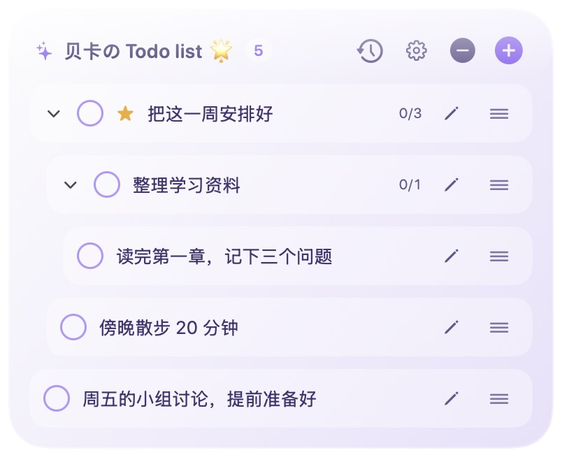 </p>
<p align="center"><sub>左：macOS v2.1.0 · 右：现有 Windows 版；均为应用实际渲染的演示数据，Windows 图来自 GitHub Windows runner，不代表新版客户端验收</sub></p>

## Mac v2.1.0：任务拆分、顺滑排序与中文输入修复

**正式下载：macOS v2.1.0；Windows 仍为 v2.0.1。** 本次只更新 Mac。Windows 新版验收已按作者要求暂停，未发布其悬浮球修复或层级功能，也不以服务器自动化代替客户端实测。

- **递归子待办**：把任务继续拆小；支持折叠、完成进度、提升一级和移动到其他父任务。
- **整组完成与恢复**：勾选父任务会连同子项完成，4 秒内可整组撤销；完成历史可恢复整个任务树。
- **拖动排序改进**：按真实行高计算位置、邻居实时让位，拖动父任务时子项一起移动；松手才保存排序，减少卡顿。
- **首次中文输入修复**：等输入框真正挂载后再聚焦；每个输入框独立维护组合文本，避免新建/编辑抢焦点；无效候选坐标回退到输入框附近。
- **长列表不会被压扁**：修复完成历史/展开清单从矮窗口切换时的裁切问题。
- **备份更安全**：含非法时间戳的文件整体拒绝，连续导入自动备份不互相覆盖。

Mac 回归：57 项数据/层级/排序测试、15 项原生菜单检查、11 项原生输入组件、7 项原生窗口布局检查通过；本机微信输入法已实际输入汉字，并完成子任务与真实鼠标拖动检查。输入法候选框在所有第三方环境下的位置并未穷尽验证，不宣称绝对无问题。保留菜单栏、右键退出、全字段编辑、紫色悬浮球等原有能力。

> **跨版本备份提醒**：不含子任务的清单仍导出 v1，兼容现有 Windows。含子任务时导出 v2；**Windows v2.0.1 和旧 Mac 不能导入这种层级备份**。不要手工删改版本号；升级前请保留原备份。

## 新功能怎么用？（Mac v2.1.0 真实截图）

以下图片直接来自本机运行的新版 Mac 界面，仅使用单独的演示清单，没有真实个人待办。演示启动器只隔离数据与通知，不重绘或生成 UI；截图展示真实操作结果。

### 1. 大任务继续拆小：子任务也可以再拆

**右键一条待办 →「添加子待办」**。在子待办上重复操作就能继续拆分；新建框上方会显示所属父任务，点「改为顶级」可改成独立事项。

<p> 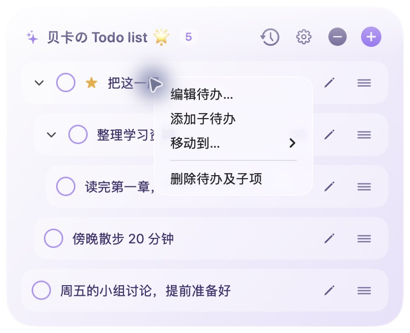</p>

### 2. 折叠不删除，完成进度一眼能看见

点父任务左侧箭头折叠/展开。`0/3` 表示三个后代任务中还没有完成；进度也计入已进入历史的子项。**折叠只是隐藏子项，不是删除。**

<p></p>

### 3. 调整层级：提升一级，或者搬到另一个任务下面

**右键子待办 →「提升一级」**，或选 **「移动到…」** 后指定新的父任务。移动的是整棵子树，孙级关系保留；不会允许把父任务塞进自己的后代中。

<p>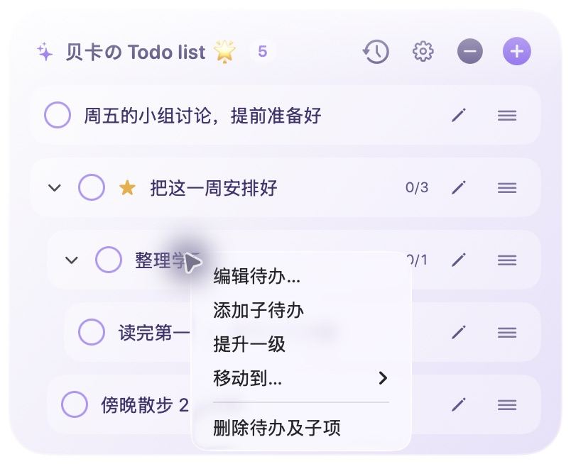</p>

### 4. 拖动更顺：父任务和子任务一起搬

按住每条右边的 **三横线手柄** 上下拖动。同级条目会让位；长标题按真实行高计算，拖动中不反复写盘。**拖父任务会带走整个子树；跨层级请使用右键「移动到…」，不要用拖动改变父子关系。**

下图对比：左边原顺序，右边把整个「把这一周安排好」移到独立任务后面，子项仍跟在父项下面。屏幕边缘自动滚动尚未提供，长清单可先滚到目标附近再拖动。

<p> 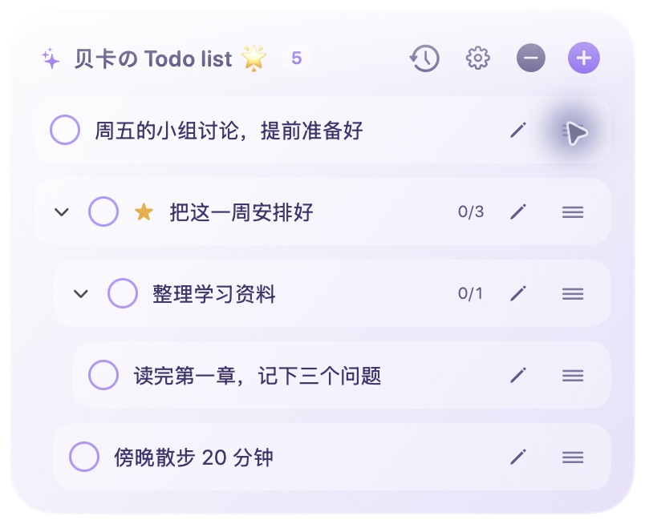</p>

### 5. 整组完成、四秒撤销和历史恢复

勾选父任务，其全部活动后代一起完成；**4 秒内再点已勾选圆圈可整组撤销**。随后进入右上方「完成历史」，在父任务上点恢复图标，整棵树都会回来。删除父任务及子项会先询问确认，永久删除不能撤销。

<p>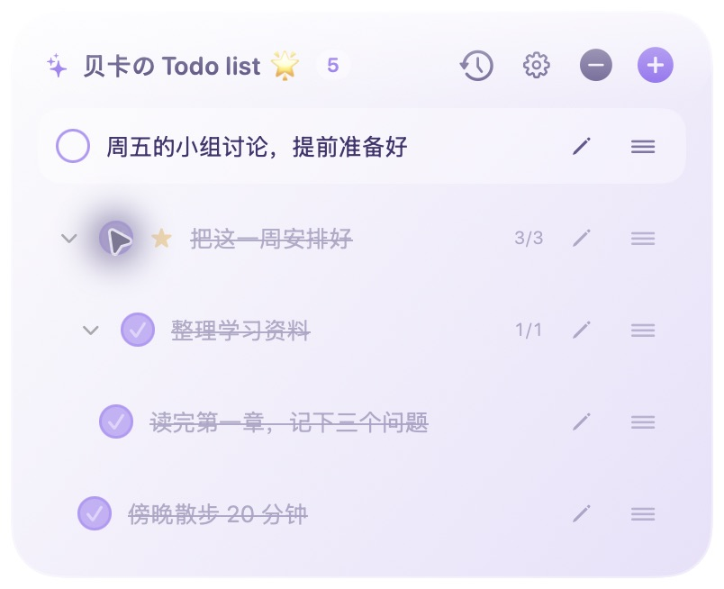 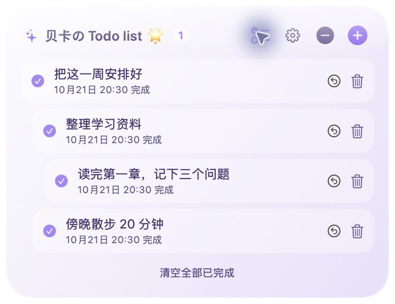</p>

### 6. 新建直接输入中文，编辑也能改时间

首次点 **＋** 或 **⌘N** 后直接输入。下图「你好」为本机微信输入法实际组合提交，不是把中文粘贴进去代替输入法测试。点待办文字或铅笔，可修改内容、重要级别、时间模式、日期和提醒。

<p>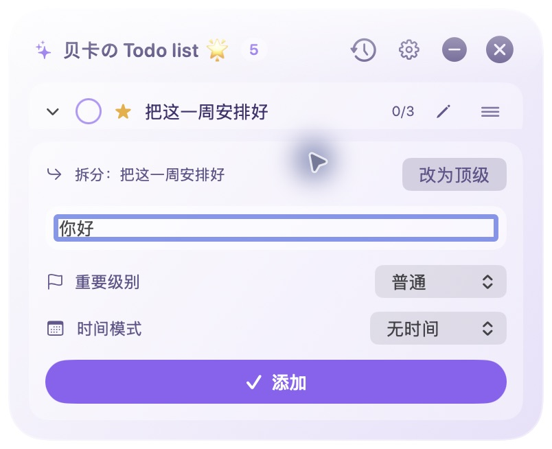 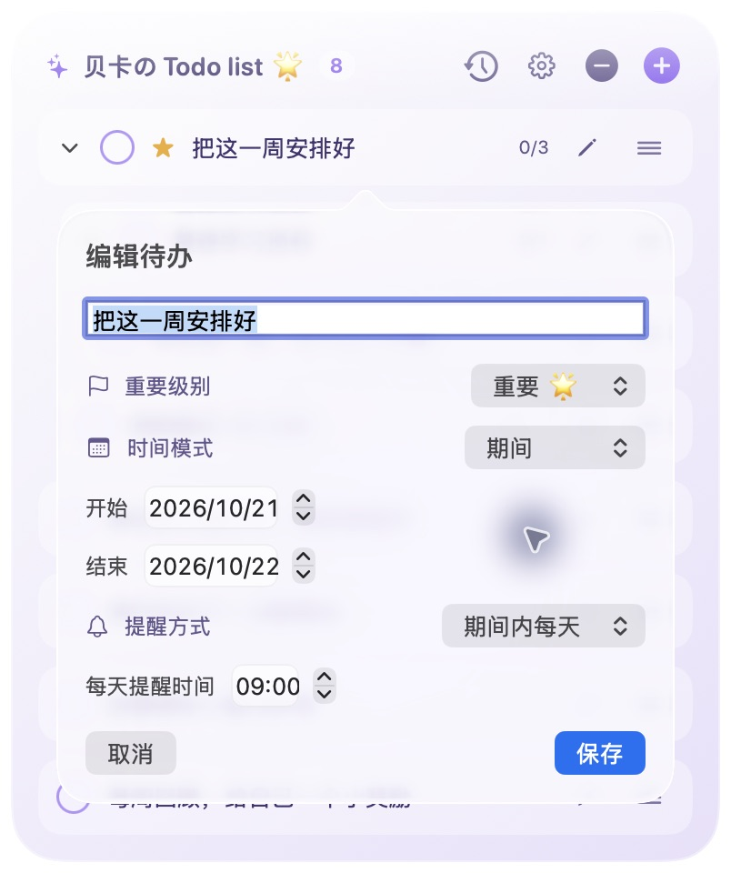</p>

### 7. 名称可以改，紫色悬浮球继续保留

点 **齿轮 → 自定义名称**，输入自己的称呼，例如「小王」，标题变成「小王の Todo list」。点 **−** 收起成 48px「干」球，点圆球恢复；右键圆球或卡片标题空白处能找到退出。深浅外观跟随系统，下图深色图是同一界面的暗色外观实际渲染。

<p>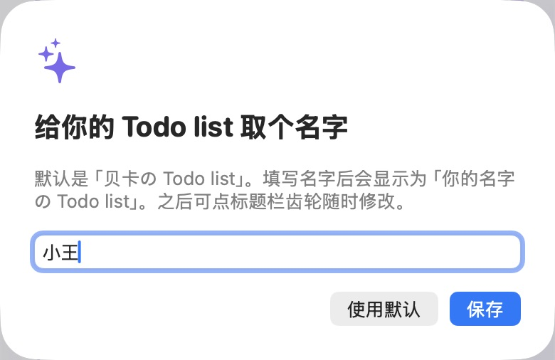 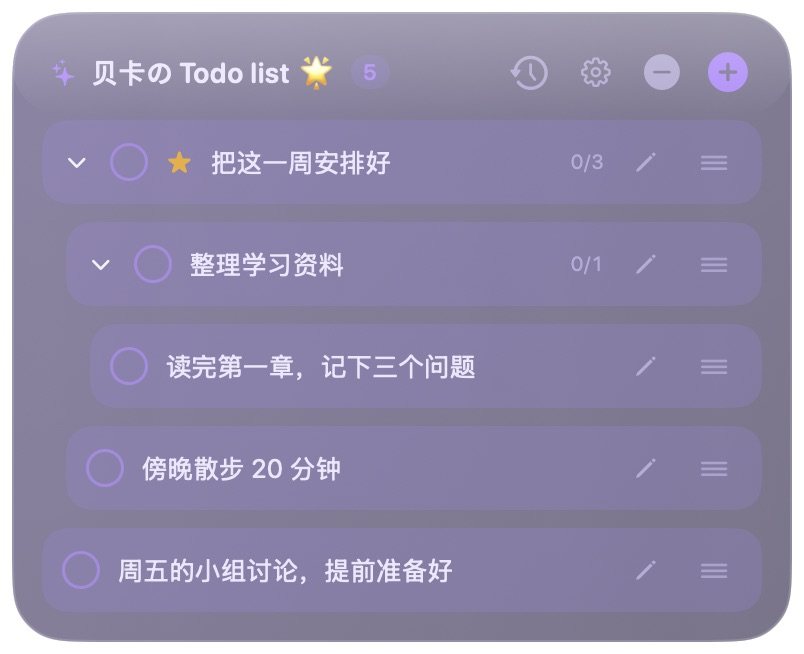</p>
<p></p>

<p>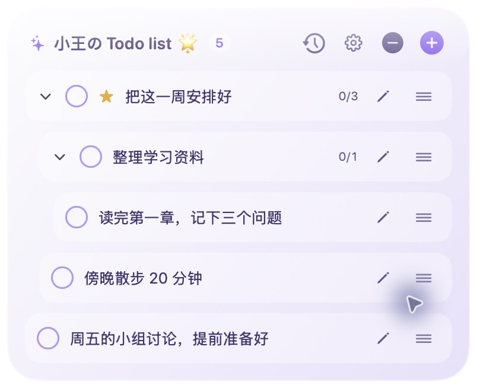</p>

### 8. 导入更安全，升级前先导出一份备份

从菜单栏或右键卡片标题空白处选择「导出备份…」。导入前自动保存本机安全备份；若文件中有无效时间戳，会拒绝整个文件，不会跳过错误记录后把现有清单清空。**有子任务的备份是 v2，仅 Mac v2.1.0 支持；现有 Windows v2.0.1 只支持不含层级的 v1。**

<p>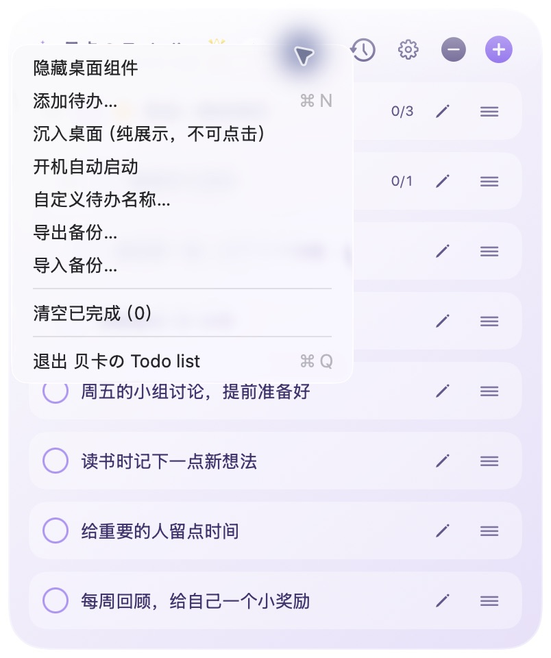</p>

## 选哪个下载？

| 你的电脑 | 下载文件 | 适合谁 | 打开方式 |
|---|---|---|---|
| **Mac（Intel 或 Apple 芯片）** | [`LiquidTodo-macOS-universal-v2.1.0.zip`](https://github.com/lyyrebecca/beka-todo-list/releases/download/v2.1.0/LiquidTodo-macOS-universal-v2.1.0.zip) | 所有 Mac 用户 | 解压后把 `LiquidTodo.app` 拖进“应用程序”，双击打开。 |
| **Windows 10 22H2 / Windows 11 x64** | [`LiquidTodo-Windows-x64-Setup-v2.0.1.exe`](https://github.com/lyyrebecca/beka-todo-list/releases/download/v2.1.0/LiquidTodo-Windows-x64-Setup-v2.0.1.exe) | 推荐，大多数 Windows 用户 | 双击安装器，按提示安装；可选桌面快捷方式与开机启动。 |
| **Windows 10 22H2 / Windows 11 x64** | [`LiquidTodo-Windows-x64-Portable-v2.0.1.zip`](https://github.com/lyyrebecca/beka-todo-list/releases/download/v2.1.0/LiquidTodo-Windows-x64-Portable-v2.0.1.zip) | 不想安装、想放 U 盘 | 解压整个文件夹，双击 `LiquidTodo.exe`；首次启动会在同级创建 `Data/`，之后不要删除它。 |

> **Windows 版无需安装 .NET。** 若 SmartScreen 显示“未知发布者”，点击 **更多信息 → 仍要运行**；这是因为目前尚未使用 Authenticode 证书。只从 [Releases](../../releases/latest) 下载，并用 `SHA256SUMS.txt` 核对文件。

## 下载后，到底双击哪个文件？（新手必看）

**Mac：打开「应用程序」里的 `LiquidTodo.app`。Windows 安装版：打开桌面或开始菜单里的「贝卡の Todo list」。Windows 便携版：打开完整解压文件夹里的 `LiquidTodo.exe`。**

### 第一步：从正确位置下载

1. 打开 [正式版下载页面（Releases）](https://github.com/lyyrebecca/beka-todo-list/releases/latest)。
2. 找到页面底部的 **Assets（资源）**，若列表折叠，先点开；按上表选择 **一个**与你的系统对应的文件即可。
3. **不要下载 `Source code (zip)` / `Source code (tar.gz)`**，也不要点项目绿色 **Code → Download ZIP**：这些是开发源码，不是可直接使用的软件。普通用户也不需要到 Packages 下载，不需要 Docker、编程工具或 .NET。

### Mac：解压 → 移到“应用程序” → 打开 App

适用 **macOS 14 或更新系统**，Intel / Apple 芯片共用同一份 Universal 包。

1. 下载 `LiquidTodo-macOS-universal-v2.1.0.zip`。
2. 在 **访达 → 下载** 中双击 ZIP 解压，打开 **`LiquidTodo-Mac-v2.1.0`** 文件夹，找到紫色图标的 **`LiquidTodo.app`** 和「START-HERE-Mac.txt（中文说明）」。如果浏览器已经自动解压，直接找这个 App，不用再次解压。
3. 把 **整个 `LiquidTodo.app`** 拖到访达左侧的 **应用程序（Applications）**。
4. 打开 **访达 → 应用程序 → `LiquidTodo.app`**，双击启动。系统隐藏 `.app` 扩展名时，可能只显示 `LiquidTodo`；中文显示名也可能是「贝卡の Todo list」。认准紫色应用图标即可。
5. 首次启动设置自己的名称，随后点主面板右上方 **＋** 添加待办。

```text
下载/LiquidTodo-macOS-universal-v2.1.0.zip
    ↓ 双击解压 → LiquidTodo-Mac-v2.1.0/LiquidTodo.app
    ↓ 把整个 App 拖到“应用程序”
应用程序/（Applications）
└── LiquidTodo.app    ← 每次使用，双击这个紫色 App
```

**不需要右键“显示包内容”，也不要进入 `Contents/MacOS/` 找内部程序。** 这是桌面/菜单栏小组件，没有常规 Dock 窗口也不代表没启动：先看桌面上的面板或紫色「干」球；被隐藏时，点屏幕顶部菜单栏的待办图标，再选“显示桌面组件 / 展开桌面组件”。

若 macOS 首次提示开发者无法验证，请先核对下载来源与 SHA-256，再到 **系统设置 → 隐私与安全性** 查看对应的打开选项；**不要关闭系统安全保护，也不要照着陌生教程执行终端解禁命令**。提示“文件已损坏”时先重新下载完整文件并校验。

### Windows 安装版（推荐）：双击 Setup，装好后打开快捷方式

适用 **Windows 10 22H2 / Windows 11 x64**。

1. 下载 **`LiquidTodo-Windows-x64-Setup-v2.0.1.exe`**。这是安装器，**不需要解压**。
2. 双击安装器，跟随提示安装；建议勾选 **创建桌面快捷方式**。是否开机启动可自行选择。
3. 安装结束后勾选启动应用，或双击桌面的 **「贝卡の Todo list」** 快捷方式。
4. 如果没创建桌面快捷方式：点 **开始菜单**，搜索 **贝卡**，打开 **「贝卡の Todo list」**。
5. 如果仍找不到：按 **Win + R**，粘贴下方路径，按回车。下方是默认安装位置；若安装时自行更改目录，请打开所选目录中的 `LiquidTodo.exe`。

```text
%LOCALAPPDATA%\Programs\LiquidTodo\LiquidTodo.exe
```

**以后打开桌面/开始菜单快捷方式即可，不要每次重新运行 `Setup` 安装器。** 自定义待办名称不会改变安装器、程序文件或默认快捷方式的名称。

### Windows 便携版：先“全部解压”，再打开 `LiquidTodo.exe`

1. 下载 **`LiquidTodo-Windows-x64-Portable-v2.0.1.zip`**。
2. 在文件资源管理器中右键 ZIP → **全部解压…**。例如解压到 `D:\Apps\LiquidTodo\`（这是示例，可以换成你自己的可写文件夹）。
3. 打开 **解压后的文件夹**，找到与许多 `.dll` 文件放在同一层的 **`LiquidTodo.exe`**，双击它。
4. 如果还套着一层文件夹，就再打开一层，直到看到 `LiquidTodo.exe`。Windows 隐藏扩展名时，它显示为 **`LiquidTodo`**，文件“类型”为 **应用程序**，不是配置文件或文件夹。
5. 首次启动会在程序旁生成 **`Data`** 文件夹，保存你的待办和设置；以后继续从这里的 `LiquidTodo.exe` 打开。

```text
D:\Apps\LiquidTodo\                  ← 示例：完整解压得到的文件夹
├── LiquidTodo.exe                   ← 双击这个！类型为“应用程序”
├── LiquidTodo.dll                   ← 不点、不单独移动
├── LiquidTodo.runtimeconfig.json    ← 配置文件，不是启动入口
├── Assets\                          ← 资源，保留
├── portable.flag                    ← 便携模式标识，保留
├── …其他 DLL / 子文件夹             ← 全部保留
└── Data\                            ← 首次运行后生成；你的待办，别删除
```

**不要在 ZIP 压缩包预览里直接运行，也不要只把 EXE 拖到桌面！** 程序依赖同目录资源，必须保留整个解压文件夹。想从桌面快速打开，请右键 `LiquidTodo.exe` → **发送到 → 桌面快捷方式**（Windows 11 可先点“显示更多选项”）；不要移动 EXE 本体。

便携版升级前先退出应用并备份整个 `Data` 文件夹。解压新版、保留原 `Data` 再启动；不要删除旧文件夹后才想起备份。安装版数据在 `%LOCALAPPDATA%\LiquidTodo\`，便携版在 EXE 同级 `Data\`，两者不是同一个目录。

### 双击了，但找不到界面？

- **Windows**：先看屏幕边缘的紫色「干」球，点一下展开；再看任务栏右下角，点 **⌃ 显示隐藏图标**，右键待办图标 → **显示 / 隐藏**。开机启动也可能以圆球或上次状态出现。
- **Mac**：看屏幕边缘的「干」球，或屏幕顶部菜单栏的待办图标，选择显示/展开组件。菜单栏图标被挤掉时，可右键卡片标题栏空白处或紫色圆球打开备用菜单，其中有退出入口；退出后双击“应用程序”里的 `LiquidTodo.app` 重开。不要因为 Dock 没出现常规窗口就重复启动。
- **v2.0.1 已知问题**：Windows 悬浮球拖动后可能移出工作区，修复版仍未完成客户端验收，目前已暂停 Windows 测试，尚未正式发布。旧版没有“找回窗口”菜单；不要把该候选版操作当作旧版已有功能。
- 若任务管理器中进程出现后立即消失，不算启动成功；先确认完整解压，再参考本页末尾 **Windows Portable 无法启动？** 收集诊断日志。

## 三步开始使用

1. 下载上表中与你的系统对应的文件并打开应用。
2. 第一次启动会询问名称：可用默认“贝卡”，也可填写“小王”，标题即显示为“小王の Todo list”。之后随时点标题栏 **⚙** 修改。
3. 点 **＋** 新建待办；可设普通 / 重要 / 紧急、截止日期 / 某一天 / 期间，以及到时、前一天 21:00、期间每日提醒。

### 日常操作

- **编辑**：点击待办文字；标题、级别、日期、时间和提醒均可修改。
- **排序**：拖动每条最右侧的 `⋮⋮` 手柄；重要 / 紧急项目创建后自动置顶。
- **退出 / 重开（Mac）**：菜单栏待办图标 →「退出」，或右键卡片标题栏空白处 / 紫色圆球 →「退出」；重新双击“应用程序”中的 `LiquidTodo.app`。
- **收起**：点 `−` 变为紫色「干」圆球，拖到屏幕边缘会自动吸附；点击圆球恢复。
- **完成**：勾选后有 4 秒撤销窗口；完成历史可恢复或清空。
- **备份**：托盘菜单中选择“导出备份 / 导入备份”。导入默认安全合并，按 UUID 去重，导入前自动备份本机数据。

## 功能

| 能力 | macOS | Windows x64 |
|---|---:|---:|
| 创建、完整编辑、拖动排序、三级重要度 | ✅ | ✅ |
| 子任务拆分、折叠、进度、整树操作 | ✅ v2.1.0 | 未发布 |
| 截止日期、某一天、期间与提醒 | ✅ | ✅ |
| 完成、4 秒撤销、历史恢复 | ✅ | ✅ |
| 中文输入法、悬浮球、托盘、开机启动 | ✅ | ✅ |
| 自定义 `xxの Todo list` 名称 | ✅ | ✅ |
| 平面清单 JSON 导入 / 导出（v1） | ✅ | ✅ |
| 层级备份（v2） | ✅ v2.1.0 | 不支持 |

## 数据与隐私

完全离线：无账号、遥测、广告、云同步或自动更新。

- **Mac**：`~/Library/Application Support/LiquidTodo/`
- **Windows 安装版**：`%LOCALAPPDATA%\LiquidTodo\`
- **Windows 便携版**：应用同级 `Data/`

备份格式为 [LiquidTodo Backup v1](shared/backup-schema/liquidtodo-backup-v1.schema.json)，可在 Mac 和 Windows 间手动迁移。

常规用户请从 [GitHub Releases](../../releases/latest) 选择上表对应的安装包。GitHub Packages 中的 `ghcr.io/lyyrebecca/beka-todo-list` 是下载文件镜像，包含 macOS ZIP、Windows Setup EXE、Windows Portable ZIP 和 SHA-256 清单，供偏好容器仓库的用户下载；不需要 Docker 的用户无需使用它。

## 开发与验证

```bash
# macOS
./test.sh && ./Tests/run-status-item-tests.sh && ./build.sh

# Windows（Windows x64 上）
dotnet test windows/LiquidTodo.Windows.sln
dotnet publish windows/src/LiquidTodo.Windows -c Release -r win-x64 --self-contained true
```

Windows CI 会跑单元测试并构建自包含发布产物；最新通过记录见 [Actions](../../actions)。

### Windows Portable 无法启动？

请确认先**完整解压 ZIP**，而不是在压缩包预览中直接双击，也不要只拷走 `LiquidTodo.exe`。Portable 版本必须与同目录的 DLL、`LiquidTodo.runtimeconfig.json`、资源文件一起运行。

若双击后进程仍立即退出，请运行：

```powershell
.\LiquidTodo.exe --safe-mode --diagnostics
```

它会跳过托盘、通知和桌面展示模式，只打开基础待办面板；启动错误会写入同级 `Data\Logs\startup-*.log`。请附上该日志与 Windows 版本信息提交 Issue。Windows 便携包内包含 `manifest.json`（包内逐文件 SHA-256），每个 Release 另提供总文件 `SHA256SUMS.txt`，可用于确认下载完整性。

[MIT](LICENSE)
