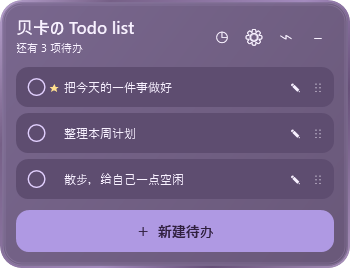
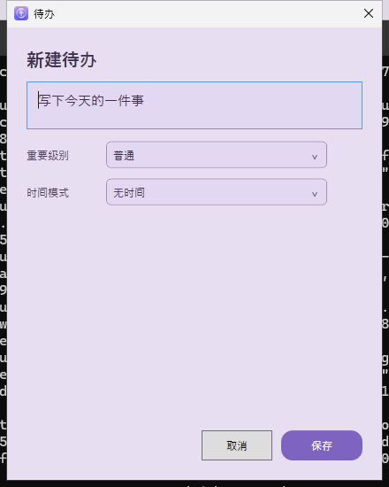
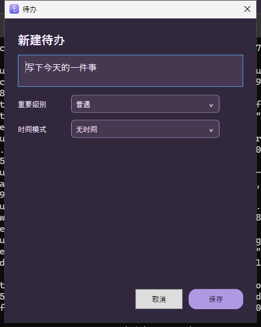

# Windows v2.0.2 候选版图形回归

## 这是什么图？

以下图来自候选包 `62c01ae` 的真实 WPF 运行/渲染，使用三条演示待办。不是 AI 生成图，也不是 Windows 10/11 客户端实测截图。

环境：Windows Server 2025 Datacenter build 26100，96 DPI（100%），1024×768；[最终包工作流](https://github.com/lyyrebecca/beka-todo-list/actions/runs/38671722628)。

| 白天：轻雾紫 | 夜间：烟紫玻璃 |
|---|---|
|  |  |
|  |  |

悬浮球： 

## 自动化通过项

- 85 项数据、备份、提醒、几何与配色测试；Win-x64 自包含构建。
- 最终 Setup 安装、实际启动、登录启动注册和卸载；最终 Portable 解压即用。
- 首次命名、四种时间模式完整编辑、提醒和优先级、二次启动导入路径转发。
- 原生鼠标拖动排序、完成撤销、归档恢复与清空、删除、Ctrl+N、空白拒绝、重启持久化。
- 100 次收起/展开、200 次真正鼠标按下/移动/松开；检查进程、窗口工作区边界和第二实例退出，保留录像及轨迹。
- 日→夜→日实时切换：同时核对背景、三条待办行颜色和实际文字像素，避免只改面板、列表颜色滞留。
- 检查悬浮球原生文字为 U+5E72“干”；桌面截图与窗口下方真实像素对比，原生导出 PNG 四角 alpha=0，中心正常绘制。
- 修复夜间下拉框浅字浅底；完整编辑窗截图不再误取其父窗口范围。

## 保留的问题记录与未覆盖条件

早前一次压力验收在第 97 轮出现“拖动无水平位移”，当时进程存活且没有越界，不能称为已确认的程序退出。后续多轮严格 100 轮验收通过；现已增加仅在 `--diagnostics` 下记录的原生/WPF 鼠标捕获日志，保留旧失败证据，没有删除断言来凑通过。

Windows 10 22H2、Windows 11 x64 客户端、真实混合 DPI 多屏、微软拼音/微信输入法的候选框与组合输入、通知中心实际弹窗仍未完成。UTM 独立 x64 QA 副本加载官方 Windows 11 评估 ISO 后，等待超过 20 分钟仍未进入安装器；已停止，未接受许可或创建账户。

**因此只准备 Draft，不把 runner 截图当客户端验收，不将 v2.0.2 标为正式 Latest，也不更新 Packages latest。** [机器可读验收清单](v2.0.2-acceptance.json) / [完整修改与下载说明](v2.0.2-release-notes.md)。
